# LR6
Лабораторная работа №6
# Лабораторная работа №6. Система контроля версий

**Дисциплина:** Основы программирования
**Студент:** гр. 4517 Малашенко Н. В.
**Преподаватель:** ассистент К. Ю. Рыжов

## Цель работы

Изучение базовых возможностей системы управления версиями, получение опыта работы с Git API, с локальным и удалённым репозиторием.

## Ход работы

Работа выполнена в форке репозитория https://github.com/Kurtyanik/LR6/. Все скриншоты находятся в папке `screenshots`.

### 1. Настройка клиента Git

Указаны имя пользователя в формате «Группа Фамилия И.О.» и email.

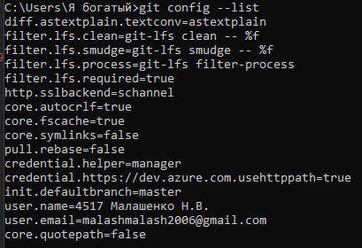

### 2. Клонирование репозитория

Личный удалённый репозиторий клонирован на компьютер.

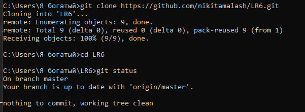

### 3. Добавление файла через интерфейс GitHub, получение изменений и создание побочной ветки

Файл `web_file.txt` создан в интерфейсе GitHub, затем изменения подтянуты командой `git pull`.

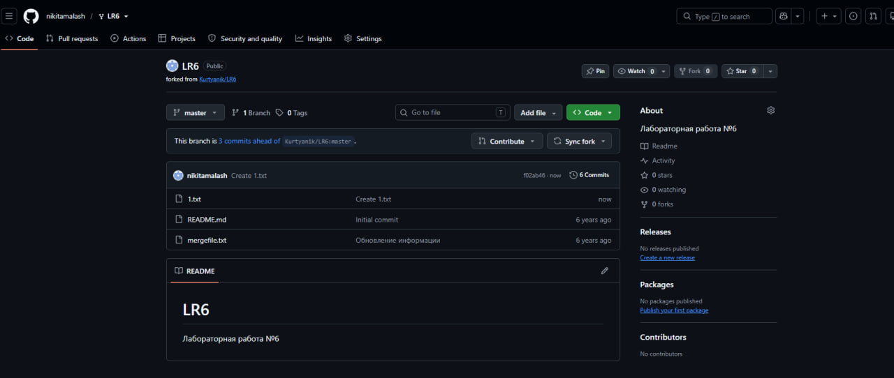
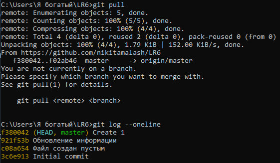

Поскольку в форке нет побочных веток, создана ветка `side` и сделаны изменения в `side` и `master`.

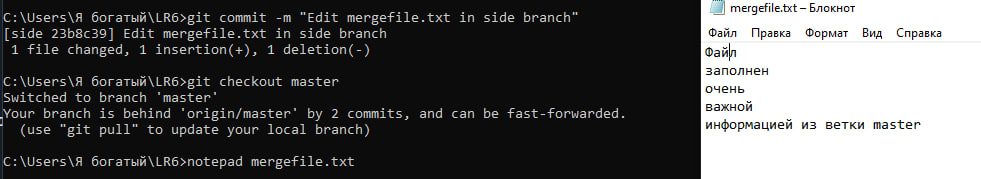

### 4. История операций веток и просмотр изменений

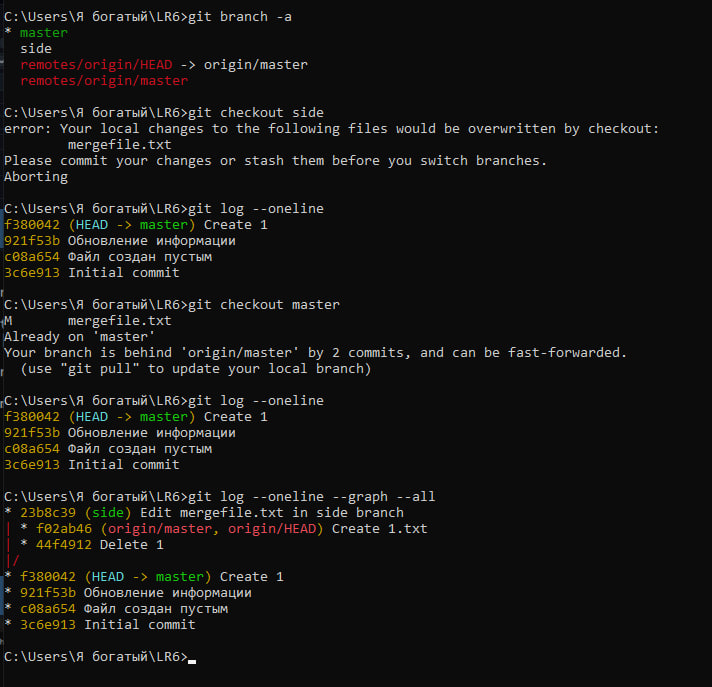
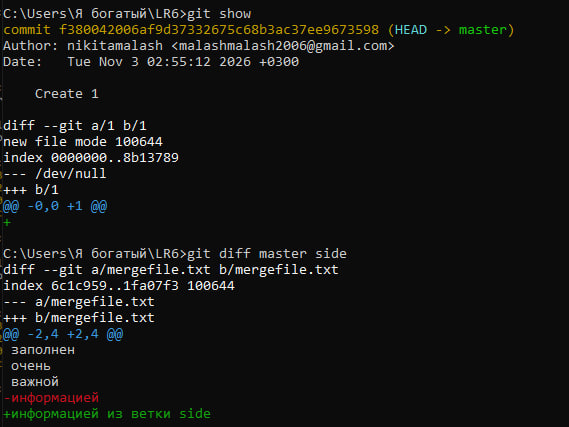

### 5. Слияние в master и разрешение конфликта

В форке была только ветка `master`, поэтому побочная ветка `side` создана вручную. В обеих ветках изменена последняя строка файла `mergefile.txt` (в `side` — «информацией из ветки side», в `master` — «информацией из ветки master»). При слиянии `side` в `master` возник конфликт в `mergefile.txt`; он разрешён вручную в текстовом редакторе: строки с маркерами конфликта (`<<<<<<<`, `=======`, `>>>>>>>`) удалены, а вместо двух версий последней строки оставлена объединённая «информацией из веток master и side». После этого файл добавлен в индекс и создан коммит слияния (`633d457`). Первая попытка слияния (коммит `608428b`) была выполнена некорректно: в истории он является обычным коммитом и не содержит ветку `side`, поэтому слияние было выполнено повторно, а ветка `side` восстановлена по хэшу последнего коммита (`23b8c39`). При первом разрешении конфликта были случайно удалены лишние строки файла, поэтому их вернули отдельным коммитом «Restore full mergefile.txt after conflict resolution».


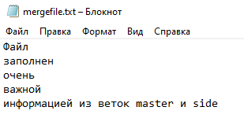
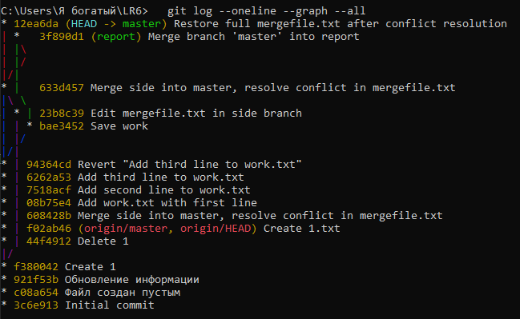

### 6. Удаление побочной ветки


### 7. Коммиты с комментариями

Сделано несколько коммитов с комментариями.

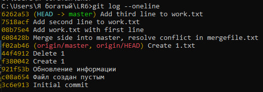

### 8. Откат коммита

Для отката использована команда `git revert`, она создаёт новый коммит, отменяющий последний, и сохраняет историю.

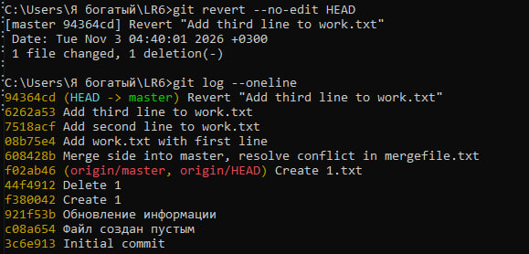

### 9. Ветка для отчёта

Для оформления отчёта создана ветка `report`. Отчёт оформляется в файле `README.md`, коммиты делались по ходу работы.

## Лог команд


```
git pull
notepad mergefile.txt
git merge side
notepad mergefile.txt
git add mergefile.txt
git commit -m "Merge side into master, resolve conflict in mergefile.txt"
   git log --oneline --graph --all
git branch -d side
git branch -a
git branch -d side
git branch -D side
git branch -a
echo First line>> work.txt
git add work.txt
git commit -m "Add work.txt with first line"
echo Second line>> work.txt
git add work.txt
git commit -m "Add second line to work.txt"
echo Third line>> work.txt
git add work.txt
git commit -m "Add third line to work.txt"
git log --oneline
git revert --no-edit HEAD
git log --oneline
git checkout -b report
mkdir screenshots
   git pull
git branch
git status
git add .
git commit -m "Save work"
git checkout master
   git branch side 23b8c39
   git merge side
notepad mergefile.txt
git add mergefile.txt
git commit -m "Merge side into master, resolve conflict in mergefile.txt"
git log --oneline --graph --all
 git branch -d side
   git branch -a
git checkout report
   git merge master --no-edit
git checkout master
notepad mergefile.txt
   git add mergefile.txt
git commit -m "Restore full mergefile.txt after conflict resolution"
   git log --oneline --graph --all
git checkout report
git merge master --no-edit
doskey /history > commands.txt

```

## История операций

Формат: сокращённый хэш, дата, имя автора, комментарий (`git log --pretty=format:"%h %ad %an %s" --date=short`).

```
3621d30 2026-11-03 4517 Малашенко Н.В. Add report text and command log
901501d 2026-11-03 4517 Малашенко Н.В. Add screenshots for steps 1-12
8071791 2026-11-03 4517 Малашенко Н.В. Merge branch 'master' into report
12ea6da 2026-11-03 4517 Малашенко Н.В. Restore full mergefile.txt after conflict resolution
3f890d1 2026-11-03 4517 Малашенко Н.В. Merge branch 'master' into report
633d457 2026-11-03 4517 Малашенко Н.В. Merge side into master, resolve conflict in mergefile.txt
bae3452 2026-11-03 4517 Малашенко Н.В. Save work
94364cd 2026-11-03 4517 Малашенко Н.В. Revert "Add third line to work.txt"
6262a53 2026-11-03 4517 Малашенко Н.В. Add third line to work.txt
7518acf 2026-11-03 4517 Малашенко Н.В. Add second line to work.txt
08b75e4 2026-11-03 4517 Малашенко Н.В. Add work.txt with first line
608428b 2026-11-03 4517 Малашенко Н.В. Merge side into master, resolve conflict in mergefile.txt
23b8c39 2026-11-03 4517 Малашенко Н.В. Edit mergefile.txt in side branch
f02ab46 2026-11-03 nikitamalash Create 1.txt
44f4912 2026-11-03 nikitamalash Delete 1
f380042 2026-11-03 nikitamalash Create 1
921f53b 2020-11-21 Kurtyanik Обновление информации
c08a654 2020-11-21 Kurtyanik Файл создан пустым
3c6e913 2020-11-21 Kurtyanik Initial commit
```

## Вывод

В ходе работы изучены основные возможности системы контроля версий Git: настройка клиента, клонирование репозитория, работа с ветками, слияние с разрешением конфликта, фиксация изменений с комментариями, откат коммита и синхронизация с удалённым репозиторием на GitHub.